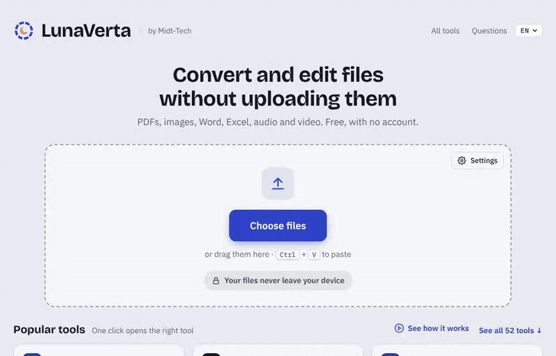

# LunaVerta

**Convert and edit files without uploading them.** A free PDF editor and file converter that runs entirely in your browser: [lunaverta.com](https://lunaverta.com)



Most online converters send your file to their server, process it there and send it back. LunaVerta doesn't have a server that receives files. Everything happens in your browser, on your own device, so contracts, payslips, ID cards and medical letters never leave it. No account, no cookies, no tracking, no ads, and it keeps working offline.

Available in English, Danish, Swedish, Norwegian, German, Spanish and French.

## What it does

- **Edit PDFs:** correct or delete existing text in the PDF's own font, move paragraphs (even to another page), add text, fill in and create forms, sign, stamp, annotate, reorder, rotate and delete pages.
- **Remove sensitive information for real:** suggestions for prices, ID numbers (CPR, personnummer, Steuer-ID, DNI, NIR and more), account and card numbers, e-mails, phone numbers, addresses and dates. Marked text is deleted from the file, not covered by a black box.
- **Convert:** HEIC, JPG, PNG, WebP, AVIF and other images; PDF to Word, Excel, JPG, PNG and text; Word, PowerPoint and Excel to PDF; CSV/JSON to Excel; video to GIF or MP3; compress phone videos.
- **52 tools in all,** including merge, split, compress, protect (AES-256), unlock, OCR in seven languages, compare two PDFs, scan paper with your phone, booklet printing, header and footer, metadata, QR codes, and removing GPS location from photos without re-encoding.

## Don't take our word for it

The privacy claim is the whole point, so it should be easy to check:

1. **Go offline.** Load the page, turn off Wi-Fi, and convert a file. It still works.
2. **Watch the network.** Open the developer tools (F12), go to the Network tab and convert a file. You'll see LunaVerta's own files load, never your file go out.
3. **Read the policy.** Every page ships a strict Content Security Policy (`connect-src 'self' blob: data:`): the browser itself refuses to send data to any other host.
4. **Read the code.** It's all here. There is no backend: `docs/` is the whole website, served as static files by GitHub Pages.

## How it works

A static site with no server code: plain HTML, CSS and JavaScript, no framework and no build step beyond generating the pages and minifying. The heavy lifting is done by self-hosted open-source libraries loaded only when a tool needs them:

| Job | Library |
| --- | --- |
| Reading and drawing PDFs | PDF.js |
| Changing PDFs (edit, merge, forms, redaction) | pdf-lib, plus LunaVerta's own content-stream editor |
| Encryption, repair | qpdf compiled to WebAssembly |
| OCR | Tesseract.js |
| Word, Excel | Mammoth, docx-preview, SheetJS |
| HEIC photos | libheif (WebAssembly) |
| Video | WebCodecs with MP4Box.js and mp4-muxer |
| MP3 | lamejs |

A service worker keeps the app and its libraries for offline use. Settings, signatures and templates are stored only in the browser's local storage.

## Run it locally

```
npm install
npm run build        # copies the libraries into docs/ and writes every page
npm run serve        # http://localhost:8080
```

Service workers only run on `localhost` or HTTPS, so open it through the server rather than as a file.

### Host it yourself

LunaVerta is a folder of static files. To run it on your own server or intranet, run `npm run build` and serve the `docs/` folder with any web server over HTTPS. There is no backend, database or configuration.

### Project layout

```
docs/                 the website, published as is (GitHub Pages)
  assets/app.js       converters and the main interface
  assets/editor.js    the PDF editor and Remove sensitive
  assets/strings*.js  interface texts, one file per language
src/template.html     the page template
scripts/
  build-pages.mjs     writes the front page and one page per tool in every language,
                      the guides, sitemap.xml, llms.txt and llms-full.txt
  site-content.mjs    tool list and English/Danish page texts
  lang/*.mjs          page texts for each extra language (sv, no, de, es, fr)
  guides*.mjs         the guides, adapted to each country
  vendor.mjs          copies the libraries from node_modules into docs/vendor
tests/smoke.mjs       end-to-end tests in a real browser
```

## Tests

```
npx playwright install chromium   # once
npm test
```

`tests/smoke.mjs` serves `docs/` and drives a real browser through the important paths: every page loads, conversions produce valid files, redaction really deletes text, OCR reads each language, signatures land on every page, every language has its texts, and the site fits a phone.

## Contributing

Bug reports, translations and fixes are welcome. See [CONTRIBUTING.md](CONTRIBUTING.md). For security issues, see [SECURITY.md](SECURITY.md).

## Licence

LunaVerta is free software under the [GNU Affero General Public License v3.0](LICENSE). You may use, study, change and share it. If you run a modified version as a website, you must offer its source code to its users too.

The bundled libraries and fonts keep their own licences (MIT, Apache 2.0, BSD, ISC, LGPL 3.0, SIL OFL); see [THIRD_PARTY_NOTICES.md](THIRD_PARTY_NOTICES.md) and [lunaverta.com/licenses.html](https://lunaverta.com/licenses.html).

Copyright © 2026 [Midt-Tech](https://midttech.com/), Aarhus, Denmark (CVR 34256276).
